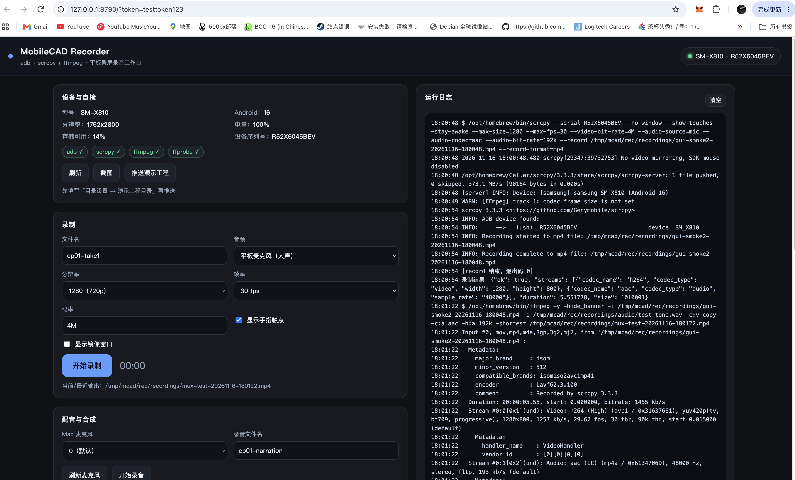

# MobileCAD Recorder

面向 Android 平板录课的 **录屏 + 录音 + 截图 + 推工程** 桌面小工具。
界面在浏览器里，底层只用三个成熟的开源工具：**adb / scrcpy / ffmpeg**，零账号、零云服务、不装平板 App。



## 为什么用它

- **稳定优先**：一次只跑一个任务；停止时先 `SIGTERM` 让 scrcpy/ffmpeg 正常收尾（MP4 的 moov 一定写完），
  超时才强杀；所有外部命令失败都写进日志，界面不会崩。
- **看得见点击**：录制时显示手指触点，教学视频里观众知道你在点哪。
- **配置不丢**：设置存在 `~/Library/Application Support/MobileCAD Recorder/config.json`；
  目录不可写时自动退到临时目录，启动不会因为权限问题失败。
- **只监听本机**：服务绑定 `127.0.0.1`，接口要一次性 token，局域网里的其他机器访问不了。
- **零依赖安装**：`python3` + 三个命令行工具，没有 pip 包、没有 Electron。

## 功能

| 模块 | 说明 |
|---|---|
| 设备自检 | 型号、Android 版本、分辨率、电量、存储；adb/scrcpy/ffmpeg/ffprobe 是否就绪 |
| 录制 | 1920/2560/1600/1280 长边，30/60 fps，码率可调；音频可选「平板麦克风 / 设备内部声音 / 无声」；可显示手指触点、镜像窗口 |
| 截图 | 一键存到 `recordings/stills/` |
| 推工程 | 把 `demo/` 里的 `.FCStd/.stl/.step/.ifc` 推到 `/sdcard/Download/MobileCAD-demo` |
| 配音 | 用 Mac 麦克风单独录一条 WAV（音质优于平板麦克风） |
| 合成 | 无声画面 + 独立录音 → 一条 MP4（`-c:v copy`，不重新编码画面） |
| 日志 | 实时输出 scrcpy/ffmpeg 全部日志，录制结束自动 ffprobe 校验时长/编码 |

## 安装

```bash
# macOS
brew install scrcpy ffmpeg
brew install --cask android-platform-tools   # 提供 adb
```

Python 3.8+（macOS 自带或 `brew install python`），**不需要任何 pip 包**。

## 启动

```bash
git clone https://github.com/Toobe53/mobilecad-recorder.git
cd mobilecad-recorder
./run.command          # macOS 双击也可以
# 或者：python3 app.py --port 8765
```

浏览器会自动打开 `http://127.0.0.1:8765/?token=...`。
关闭终端（Ctrl+C）即退出，录制中的任务会先正常收尾再退出。

## 使用流程

1. 平板：开发者选项 → USB 调试；USB 连接后允许调试；
2. 打开工具，右上角出现设备名即连接成功；
3. 「目录设置」里填演示工程目录（例如课程里的 `video-course/demo`），点「保存设置」；
4. 「推送演示工程」→ 平板 `下载/MobileCAD-demo`；
5. 录制：填文件名（如 `ep22-take1`）、选音频来源、点「开始录制」；
6. 讲完点「停止」——工具会等 scrcpy 写完文件，并在日志里给出 duration/编码校验；
7. 文件在 `~/Movies/MobileCAD Recorder/`（可改）。

### 音质优先的两步法

1. 录制时音频选「无声（B-roll）」；
2. 「配音与合成」→ 选 Mac 麦克风 → 开始录音 → 讲完停止；
3. 选画面 + 声音 → 「合成一条片子」。

## 稳定性设计

- `Runner` 单任务锁：录制中不会再启动第二个 scrcpy；
- 停止先发 `SIGTERM` 到**进程组**，等 12 秒仍不退才 `SIGKILL`；
  （实测：scrcpy 3.3.3 在无窗口模式下只对 `SIGTERM` 正常收尾，`SIGINT` 会留下坏的 MP4——这就是为什么不用 Ctrl+C 的默认语义）
- 文件名净化（只留字母数字、中文、`._-`），输出名带时间戳，永不覆盖；
- 配置写入使用临时文件 + `os.replace`，断电不会写坏；
- 每个 API 失败都返回结构化错误，前端用 toast 显示；
- 录完自动 `ffprobe`，日志里能看到 `duration / h264 / aac`，第一时间发现空文件。

## 目录结构

```
app.py                 HTTP 服务 + JSON API + 静态文件
recorder/core.py       设备发现、进程管理、录制/录音/合成
recorder/static/       index.html / style.css / app.js
run.command, run.sh    启动器
config.example.json    配置样例
screenshots/gui.png    界面截图
```

## 常见问题

- **没有声音**：Android 11 以下不支持音频转发；确认平板未静音；试试「设备内部声音」。
- **录制结束文件坏了**：请看日志里是否有 `[强制结束进程组]`；正常路径是 SIGTERM 收尾，若平板在录制中断开 USB，scrcpy 会异常退出，文件可能不完整。
- **画面卡顿**：换 USB 3 口/线，或把帧率降到 30、长边降到 1600。
- **Mac 麦克风列表为空**：给终端/浏览器授予「麦克风」权限；`ffmpeg -f avfoundation -list_devices true -i ""` 可查设备号。
- **端口被占用**：`python3 app.py --port 9000`。

## 开发

```bash
python3 -m py_compile app.py recorder/core.py     # 语法检查
python3 app.py --no-browser --port 8790           # 无浏览器启动
curl -H "X-Token: $TOKEN" http://127.0.0.1:8790/api/state
```

## License

MIT。adb（Apache-2.0）、scrcpy（Apache-2.0）、ffmpeg（LGPL/GPL，按你的构建）各自遵循其许可证。
